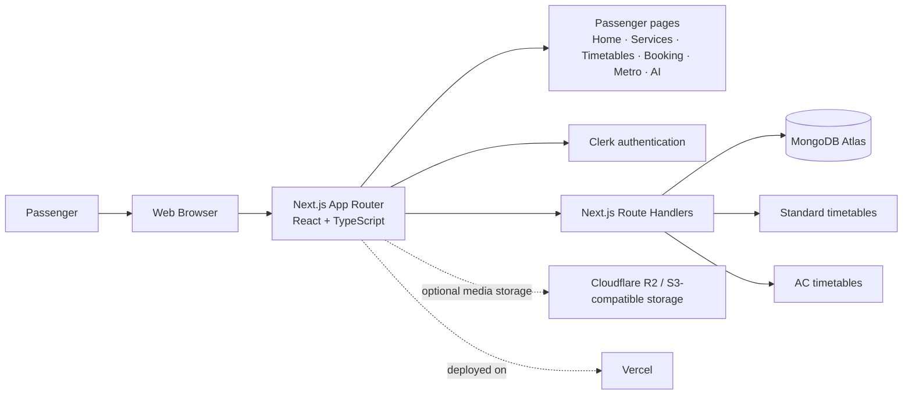
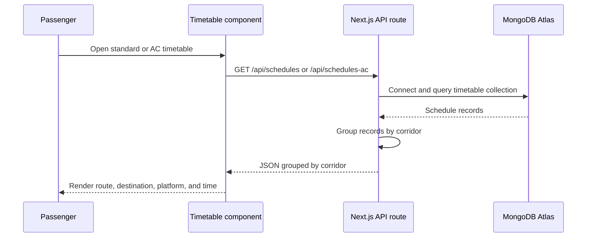

# Pettah Transit Hub

**A unified digital transit companion for discovering Sri Lankan bus routes, checking timetables, planning journeys, and exploring Pettah transport services.**


[](https://pettah-hub.vercel.app)
[](https://nextjs.org/)
[](https://www.typescriptlang.org/)
[](https://www.mongodb.com/atlas)

> **Full-stack note:** Pettah Transit Hub uses **Next.js for both the frontend and backend**. The UI is built with React and TypeScript, while server-side API Route Handlers provide timetable data and connect to MongoDB.

## Overview

Pettah Transit Hub is a responsive web platform designed around the experience of travelling through Colombo’s Pettah Central Bus Stand. It brings essential transit information and passenger services into one focused interface:

- Browse standard and AC bus timetables by corridor.
- View route numbers, destinations in English, Sinhala, and Tamil, platforms, and departure times.
- Explore bus services, facilities, emergency contacts, and transport guidance.
- Use the interactive seat-booking journey to search destinations, select seats, and generate a ticket summary.
- Ask the AI Route Assistant for help with routes, schedules, and booking-related questions.
- Discover metro-service information and related transport links.
- Sign in securely before accessing the booking experience.

**Live deployment:** [pettah-hub.vercel.app](https://pettah-hub.vercel.app)

## Product Architecture



### Timetable request flow



## Main Routes

| Route | Purpose |
| --- | --- |
| `/` | Product landing page, route guidance, help desk details, and service highlights |
| `/our-services` | Bus services, facilities, and passenger service information |
| `/timetable` | Standard bus timetable by corridor |
| `/timetable/AC` | AC bus timetable by corridor |
| `/booking` | Clerk-protected interactive seat-booking and ticket flow |
| `/metro-service` | Metro-service information and external transport resources |
| `/askAI` | AI Route Assistant interface |

## Technical Stack

| Area | Technology |
| --- | --- |
| Frontend and backend | Next.js 16 App Router |
| Language | TypeScript |
| UI | React 19, CSS, Tailwind CSS/PostCSS |
| Authentication | Clerk for Next.js |
| Data layer | MongoDB with Mongoose |
| Media integration | AWS SDK S3 client for Cloudflare R2-compatible storage |
| Icons | Lucide React |
| Deployment | Vercel |

## API Surface

| Method | Endpoint | Description |
| --- | --- | --- |
| `GET` | `/api/schedules` | Reads standard bus schedules and groups them by corridor |
| `GET` | `/api/schedules-ac` | Reads AC bus schedules and groups them by corridor |
| `POST` | `/api/upload` | Reserved upload integration for S3-compatible object storage |

## Data Model

Both timetable collections use the same shape:

```ts
{
  corridor: string;
  routeNo: string;
  destination: {
    english: string;
    sinhala: string;
    tamil: string;
  };
  platform: string;
  time: string;
}
```

- Standard schedules are stored in the `timetables` collection.
- AC schedules are stored in the `timetables-AC` collection.

## Getting Started

### Prerequisites

- Node.js 20 or newer
- npm
- A MongoDB database containing the timetable collections
- Clerk application credentials

### Installation

```bash
git clone https://github.com/ravishanamina174/Pettah_Transit_Hub.git
cd Pettah_Transit_Hub
npm install
```

Create `.env.local` with the variables required by your deployment:

```env
MONGODB_URI=your_mongodb_connection_string
NEXT_PUBLIC_CLERK_PUBLISHABLE_KEY=your_clerk_publishable_key
CLERK_SECRET_KEY=your_clerk_secret_key
R2_ENDPOINT=your_s3_compatible_endpoint
R2_BUCKET_NAME=your_bucket_name
R2_ACCESS_KEY=your_access_key
R2_SECRET_KEY=your_secret_key
```

Keep environment files out of version control. Never commit database, Clerk, or storage credentials.

### Run locally

```bash
npm run dev
```

Open [http://localhost:3000](http://localhost:3000).

### Available scripts

```bash
npm run dev       # Start the development server
npm run lint      # Run ESLint
npm run build     # Create a production build
npm run start     # Start the production server
```

## Deployment

The application is designed for deployment on Vercel:

1. Import the repository into Vercel.
2. Configure the environment variables listed above in the project settings.
3. Verify MongoDB network access allows the Vercel deployment to connect.
4. Deploy using the default Next.js build settings.
5. Confirm the public application at [pettah-hub.vercel.app](https://pettah-hub.vercel.app).

## Project Structure

```text
app/
├── api/
│   ├── schedules/route.ts       # Standard timetable API
│   ├── schedules-ac/route.ts    # AC timetable API
│   └── upload/route.js          # Object-storage upload integration
├── askAI/                       # AI Route Assistant page
├── booking/                     # Protected booking page
├── metro-service/               # Metro information page
├── our-services/                # Service and facility information
├── timetable/                   # Standard and AC timetable pages
├── layout.tsx                   # Root layout and Clerk provider
└── page.tsx                     # Home page
components/                      # Navigation, timetable, chatbot, and booking UI
lib/                             # MongoDB and storage clients
models/                          # Mongoose timetable models
public/                          # Product imagery and static assets
proxy.ts                         # Clerk route protection middleware
```

## Current Scope

The project is structured as a full-stack transit product prototype. Timetables are retrieved through the MongoDB-backed API routes, while the current seat-selection and payment screens demonstrate the end-to-end passenger interaction in the client. A production booking release would connect this flow to persistent reservations, payment processing, inventory locking, and ticket delivery.

## License

No open-source license has been specified for this repository. Contact the repository owner before redistributing or reusing the code.
